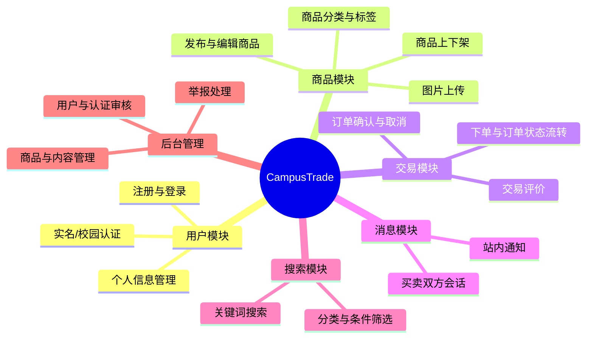
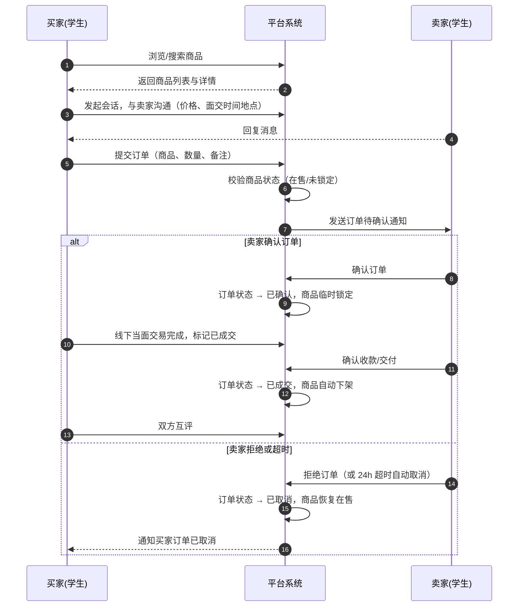

# CampusTrade 校园二手交易平台

> **课程**：微服务开发与实践
> **姓名**：林昆泽
> **学号**：2401110736
> **仓库用途**：本课程唯一项目仓库，用于记录从需求分析、单体开发到微服务拆分、测试、部署与文档整理的全过程，每周作业见 [`docs/homework/`](docs/homework/)。

## 快速开始（当前进度：Week 06 微服务拆分）

第 6 周已完成用户、商品、订单三个独立 Spring Boot 服务，使用独立数据库和账号，通过 RestTemplate 进行 HTTP 协作。原 `monolith/` 保留，新增服务位于 `services/`，基础包为 `com.zjgsu.lkz`。

- [第 6 周作业：实现过程、验证结果与四张实际运行截图](docs/homework/week-06/index.md)
- [服务边界设计与 Mermaid 架构图](docs/microservices-design.md)
- [微服务运行、配置与接口说明](services/README.md)

| 服务 | 端口 | 数据库 | 数据表 |
| --- | --- | --- | --- |
| user-service | 8081 | campustrade_users | users |
| product-service | 8082 | campustrade_products | items |
| order-service | 8083 | campustrade_orders | trade_orders |

商品发布前通过 HTTP 校验卖家；下单先校验买家，再请求商品服务锁定商品，最后保存订单。各服务只读写自己的数据库，跨服务保存 ID，不直接访问其他服务的 Repository。依赖资源不存在返回 404，业务冲突返回 409，依赖不可用或超时返回 503；校验失败不新增订单。

### 启动与验证（仓库根目录）

启动需要运行中的 Docker Desktop；镜像内完成编译，无需本机安装 Java 或 Maven。本地教学默认配置可直接启动，密码覆盖变量见 [services/.env.example](services/.env.example)。

```bash
docker compose up -d --build
docker compose ps
# 以下命令需要 Bash、curl、Python 3；Windows 可在 Git Bash 中执行
bash scripts/smoke-test.sh
# 额外验证依赖停机：短暂停止商品服务，检查 503 和订单数不变，退出时恢复
bash scripts/smoke-test.sh --with-outage
docker compose down  # 保留三个数据库的命名数据卷
```

三个服务均提供 `GET /actuator/health`。已实测六个容器全部 healthy、下单/取消/成交成功、404/409/503 失败场景和数据库容器重建后数据保留。远端成功但本地写入失败仍存在一致性窗口，分析见设计文档；本周未实现跨服务原子事务或自动补偿。

### 运行测试（仓库根目录）

本机需要 JDK 25 和 Maven；测试使用 H2，不依赖 MySQL 或 Docker。

```bash
mvn -f services/user-service/pom.xml test
mvn -f services/product-service/pom.xml test
mvn -f services/order-service/pom.xml test
mvn -f monolith/pom.xml test
```

三个微服务分别有 2、3、5 个测试，共 10 个全部通过；保留的单体另有 28 个回归测试通过。未安装 Maven 时，进入对应工程目录执行 `./mvnw test`，PowerShell 使用 `.\mvnw.cmd test`。

## 单体版本运行方式（Week 04 / Week 05，保留对照）

### 方式一：Docker 一键启动（推荐，Week 05）

**环境要求**：安装 Docker Desktop 并处于运行状态（`docker --version`、`docker compose version` 可正常输出）。无需本机安装 JDK 或 Maven——镜像构建全部在容器内完成。

#### 1. 准备环境变量

```bash
cp .env.example .env        # Windows PowerShell 用：copy .env.example .env
# 用记事本/编辑器打开 .env，把两处 choose-... 占位符改成真实密码
```

`.env` 已被 `.gitignore` 忽略，不会提交；真实密码只存在于本机。

#### 2. 构建镜像并一键启动

```bash
docker build -t campustrade:week05 ./monolith   # 多阶段构建，生成可运行镜像
docker compose -f compose.monolith.yaml up -d --build                    # 一键启动 app + mysql（compose 自动完成构建）
docker compose -f compose.monolith.yaml ps                               # 查看状态：app 应为 running，mysql 应为 healthy
docker compose -f compose.monolith.yaml logs -f app                      # 需要时查看应用日志，Ctrl+C 退出
```

#### 3. 停止与清理

```bash
docker compose -f compose.monolith.yaml down          # 停止并删除容器，命名数据卷 mysql-data 保留（数据不丢）
docker compose -f compose.monolith.yaml up -d         # 再次启动，数据原样恢复
docker compose -f compose.monolith.yaml down -v       # ⚠️ 连同数据卷一起删除，会丢失全部数据，仅在需要重置时使用
```

#### 4. 调用接口验证（容器化）

```bash
# 健康检查（200，{"status":"UP"}）
curl -i http://localhost:8080/actuator/health

# ① 创建商品（201）
curl -i -X POST http://localhost:8080/api/items \
  -H 'Content-Type: application/json' \
  -d '{"sellerId":"u-seller","title":"九成新自行车","description":"毕业转让","price":120.00}'

# ② 查询在售商品列表（200）
curl -i http://localhost:8080/api/items

# ③ 下单：把 ITEM_ID 换成 ① 返回的商品 id（201）
curl -i -X POST http://localhost:8080/api/orders \
  -H 'Content-Type: application/json' \
  -d '{"itemId":"ITEM_ID","buyerId":"u-buyer"}'

# ④ 查询订单详情：把 ORDER_ID 换成 ③ 返回的订单 id（200）
curl -i http://localhost:8080/api/orders/ORDER_ID
```

### 方式二：本地开发（Week 04 方式，仍然可用）

**环境要求**：JDK 25（`java --version` 验证），Maven 无需预装（工程自带 Maven Wrapper，自动下载 Maven 3.9.16）。本地运行需要 MySQL 8.4；**运行测试不需要 MySQL**（测试使用 H2 内存库，自动准备数据）。

### 1. 准备本地 MySQL（首次）

安装并启动 MySQL 8.4 后，在 MySQL 客户端执行：

```sql
CREATE DATABASE IF NOT EXISTS campustrade;
CREATE USER IF NOT EXISTS 'campustrade'@'localhost' IDENTIFIED BY '自己设一个密码';
GRANT ALL PRIVILEGES ON campustrade.* TO 'campustrade'@'localhost';
```

应用通过环境变量读取连接信息（`monolith/src/main/resources/application.yml`）：

- `DB_URL`（默认 `jdbc:mysql://localhost:3306/campustrade`）
- `DB_USER`（默认 `campustrade`）
- `DB_PASSWORD`（**无默认值，必须设置**）

### 2. 运行测试（不需要 MySQL）

```bash
cd monolith
./mvnw test               # Windows PowerShell 用 .\mvnw.cmd test；28 个测试应全部通过
```

### 3. 启动应用

```bash
# Linux / macOS：
export DB_PASSWORD='自己设的密码'
# Windows PowerShell：
#   $env:DB_PASSWORD = '自己设的密码'
./mvnw spring-boot:run    # 启动应用，默认端口 8080
```

### 4. 调用接口验证

```bash
# ① 发布商品（201）
curl -i -X POST http://localhost:8080/api/items \
  -H 'Content-Type: application/json' \
  -d '{"sellerId":"u-seller","title":"九成新自行车","description":"毕业转让","price":120.00}'

# ② 浏览在售商品列表（200）
curl -i http://localhost:8080/api/items

# ③ 下单：把 ITEM_ID 换成 ① 返回的商品 id（201；商品随即被锁定 RESERVED）
curl -i -X POST http://localhost:8080/api/orders \
  -H 'Content-Type: application/json' \
  -d '{"itemId":"ITEM_ID","buyerId":"u-buyer"}'

# ④ 取消订单：把 ORDER_ID 换成 ③ 返回的订单 id（200；商品回到在售）
curl -i -X POST http://localhost:8080/api/orders/ORDER_ID/cancel
```

主要接口一览：

| 接口 | 方法 | 成功状态 | 说明 |
| --- | --- | --- | --- |
| `/api/items` | POST | 201 | 发布商品（价格必须大于 0，否则 400） |
| `/api/items` | GET | 200 | 在售商品列表 |
| `/api/items/{id}` | GET | 200 / 404 | 商品详情 |
| `/api/orders` | POST | 201 / 400 / 404 / 409 | 下单（商品须在售、非卖家本人、无进行中订单） |
| `/api/orders/{id}` | GET | 200 / 404 | 订单详情 |
| `/api/orders?buyerId=xx` | GET | 200 | 某买家的订单列表 |
| `/api/orders/{id}/cancel` | POST | 200 / 404 / 409 | 取消订单，商品回到在售 |
| `/api/orders/{id}/complete` | POST | 200 / 404 / 409 | 确认成交，商品标记售出 |
| `/api/hello` | GET | 200 | 工程起步时的运行状态验证接口（保留） |
| `/actuator/health` | GET | 200 | 健康检查 |

**单体版本已实现的业务能力（Week 04 / Week 05）**：商品发布与在售列表查询、下单/取消/确认成交的完整订单流程（含「不能买自己的商品、不能重复下单」等业务规则）、MySQL 持久化、Docker 多阶段镜像构建与 Compose 一键编排（含数据卷持久化）。尚未实现：用户注册登录、消息沟通、搜索、评价等，规划见 [docs/project-proposal.md](docs/project-proposal.md)；表结构设计见 [docs/database.md](docs/database.md)。

## 目录

- [项目简介](#项目简介)
- [业务背景](#业务背景)
- [目标用户与角色](#目标用户与角色)
- [项目目标与适用场景](#项目目标与适用场景)
- [功能模块划分](#功能模块划分)
- [核心业务流程](#核心业务流程)
- [当前范围与暂不实现的内容](#当前范围与暂不实现的内容)
- [后续演进方向](#后续演进方向)
- [仓库结构](#仓库结构)
- [文档导航](#文档导航)

## 项目简介

CampusTrade 是一个面向高校校园的二手闲置物品交易平台。学生可以在平台上发布自己不再使用的教材、数码产品、生活用品等闲置物品，其他学生可以浏览、搜索、下单购买，并通过平台内置的消息功能与卖家沟通，完成线下或线上的交易闭环。

本项目是本学期《微服务开发与实践》课程的唯一课程项目，将按照课程节奏从单体应用起步，逐步演进为基于 Spring Cloud 的微服务架构。

## 业务背景

每年毕业季和开学季，高校学生都会产生大量的闲置物品：教材教辅、台灯、自行车、数码配件、收纳用品等。这些物品往往还有很高的使用价值，但缺乏高效的流转渠道，最后大多被低价卖给回收站或直接丢弃，造成浪费。同时，新生和在校生又常常需要以较低的价格购置这些物品。

现有的通用二手交易平台（如闲鱼）面向全社会，存在交易对象不确定、信任成本高、线下交付不便（跨城邮寄）等问题，校园内的面对面交付反而被弱化。一个**限定校园范围、以面交为主**的二手交易平台，能够显著降低信任成本和交易成本，具有明确的实际价值。

## 目标用户与角色

| 角色 | 描述 | 核心需求 |
| --- | --- | --- |
| **游客** | 未登录的访客 | 浏览商品列表与详情，了解平台内容，注册成为用户 |
| **学生（买家）** | 已认证的在校学生 | 按分类/关键词搜索商品，查看商品详情与卖家信息，下单购买，与卖家沟通，查看订单状态，对交易进行评价 |
| **学生（卖家）** | 已认证的在校学生 | 发布/编辑/下架闲置商品，管理自己发布的商品，处理订单（确认/拒绝），与买家沟通，查看交易收入 |
| **管理员** | 平台运营人员（教师/助教模拟） | 用户认证审核，违规商品与信息管理，类目维护，处理举报，平台数据概览 |

> 买家和卖家是同一类用户的两种状态，一个学生账号既可以买东西也可以卖东西，这是二手平台的典型特征。

## 项目目标与适用场景

**项目目标**

- 为校园内的二手闲置物品提供一个发布、发现、交易的闭环平台；
- 以本平台为载体，完成课程要求的微服务完整生命周期实践：需求分析 → 单体实现 → 服务拆分 → 服务治理 → 容器化部署。

**适用场景**

- 毕业季：毕业生批量处理带不走的物品；
- 开学季：新生低价购置教材和生活用品；
- 日常：学生随时处置闲置、淘换物品；
- 交易以**校内面对面交付**为主，平台不处理真实支付（详见「当前范围」）。

## 功能模块划分



| 模块 | 具体功能 | 优先级 |
| --- | --- | --- |
| 用户模块 | 注册、登录、个人资料管理、校园邮箱认证 | P0 |
| 商品模块 | 发布商品（标题、描述、价格、分类、图片）、编辑、上架/下架、删除 | P0 |
| 交易模块 | 创建订单、订单状态机（待确认 → 已确认 → 已成交/已取消）、双方互评 | P0 |
| 消息模块 | 买卖双方的站内会话、订单相关系统通知 | P1 |
| 搜索模块 | 关键词搜索、按分类/价格/发布时间筛选 | P1 |
| 后台管理 | 用户认证审核、违规商品下架、举报处理、基础数据统计 | P1 |

## 核心业务流程

以「买家下单到交易完成」为例的完整流程：



关键规则说明：

- **不接入真实支付**：校园场景以当面交付为主，交易确认由双方线下完成后在平台上标记，避免支付合规与资金安全问题。
- **商品锁定**：订单被卖家确认后商品进入锁定状态，防止一单多卖；订单取消或成交后自动解锁/下架。
- **状态机驱动**：订单状态变化只允许沿预设路径流转，保证流程可追踪、可测试。

## 当前范围与暂不实现的内容

**本期（学期内）范围**

- Web 端（浏览器访问）的学生端功能：注册登录、商品发布与管理、搜索、下单、消息、评价；
- 简单的管理员后台：认证审核、违规处理；
- 单机/容器化部署，支撑课程演示与验收。

**暂不实现**

- 真实在线支付与资金托管（使用「线下交付 + 平台标记」替代）；
- 移动端 App / 小程序；
- 物流与快递相关功能；
- 基于大数据的个性化推荐与比价；
- 多学校/多校区加盟运营。

暂不实现的原因：课程重点考察微服务的**设计、拆分与部署能力**，而非业务功能的堆叠；以上功能对本学期目标不是必需的，且会显著扩大边界。

## 后续演进方向

按照课程技术栈（Spring Cloud + Docker），平台将按以下方向逐步演进：

| 方向 | 计划 |
| --- | --- |
| **认证** | 引入 Spring Security + JWT 实现无状态登录；管理员与学生角色权限分离 |
| **服务拆分** | Week 06 已完成用户、商品、订单三个服务及独立数据库；后续扩展 API 网关（Spring Cloud Gateway）和消息服务 |
| **服务治理** | Nacos 实现服务发现与配置中心；OpenFeign 声明式服务调用；LoadBalancer 负载均衡；Resilience4j 断路器与容错 |
| **消息** | 引入消息队列（RabbitMQ），实现订单事件异步通知（如订单状态变更通知消息服务），服务间解耦 |
| **分布式事务** | 对「下单锁库存 + 创建订单」等多服务写操作，用 Seata 或最终一致性方案保证数据一致 |
| **可观测性** | Micrometer Tracing + Zipkin 分布式链路追踪；日志聚合；关键指标监控告警 |
| **部署** | 先用 Docker Compose 编排全栈服务，条件允许时迁移到 Kubernetes，实现滚动更新与弹性伸缩 |

## 仓库结构

```text
.
├── README.md                  # 项目总览（本文件）
├── compose.yaml               # Week 06：三个微服务 + 三个独立 MySQL
├── compose.monolith.yaml      # Week 05 单体编排备份
├── services/                  # 用户、商品、订单独立工程及微服务 README
├── scripts/smoke-test.sh       # 健康检查、跨服务业务与失败场景验证
├── .env.example               # 环境变量模板（复制为 .env 使用，真实密码不入库）
├── monolith/                  # 保留的单体工程（Week 03—Week 05）
│   ├── Dockerfile             # 多阶段构建：Maven 构建 + JRE 运行（Week 05）
│   ├── .dockerignore          # 镜像构建忽略规则（Week 05）
│   ├── pom.xml                # Maven 工程（Spring Boot 4.0.x / Java 25）
│   ├── mvnw                   # Maven Wrapper
│   └── src/                   # 启动类、配置、接口与测试
├── docs/
│   ├── project-proposal.md    # 项目选题说明（业务场景、核心模型与业务流程）
│   ├── database.md            # 数据库设计（Week 04）
│   ├── microservices-design.md # 服务边界、数据归属与架构图（Week 06）
│   └── homework/              # 每周作业记录
│       ├── week-01/           # 开发环境与个人仓库
│       ├── week-02/           # 项目选题与功能规划
│       ├── week-03/           # Spring Boot 工程起步
│       ├── week-04/           # 单体业务与数据库持久化
│       ├── week-05/           # Docker 容器化
│       └── week-06/           # 微服务拆分、编排、验证与截图
└── src/                       # （预留，后续按课程要求调整使用）
```

## 文档导航

- [Week 01：开发环境与个人仓库](docs/homework/week-01/index.md)
- [Week 02：项目选题与功能规划](docs/homework/week-02/index.md)
- [Week 03：Spring Boot 工程起步](docs/homework/week-03/index.md)
- [Week 04：单体应用与数据库持久化](docs/homework/week-04/index.md)
- [Week 05：Docker 容器化](docs/homework/week-05/index.md)

- [Week 06：微服务拆分、HTTP 协作与本地编排](docs/homework/week-06/index.md)
- [微服务设计与架构图](docs/microservices-design.md)
- [微服务运行与测试说明](services/README.md)
