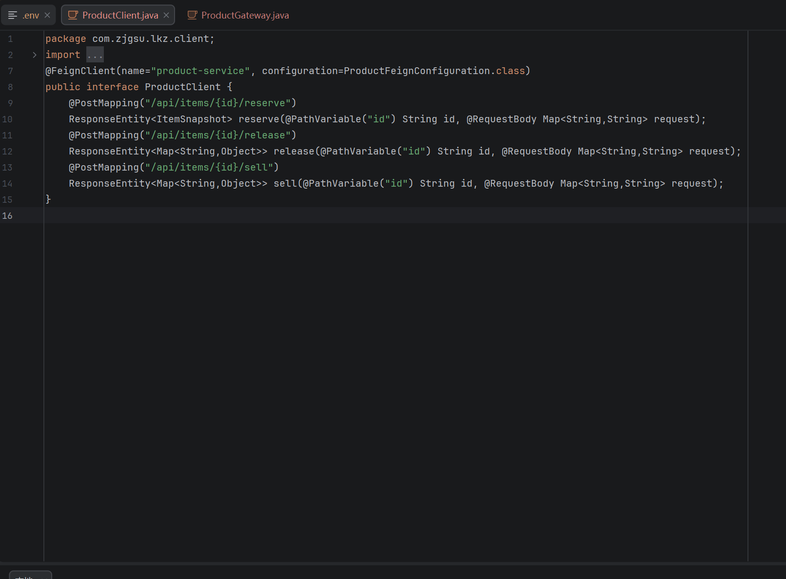
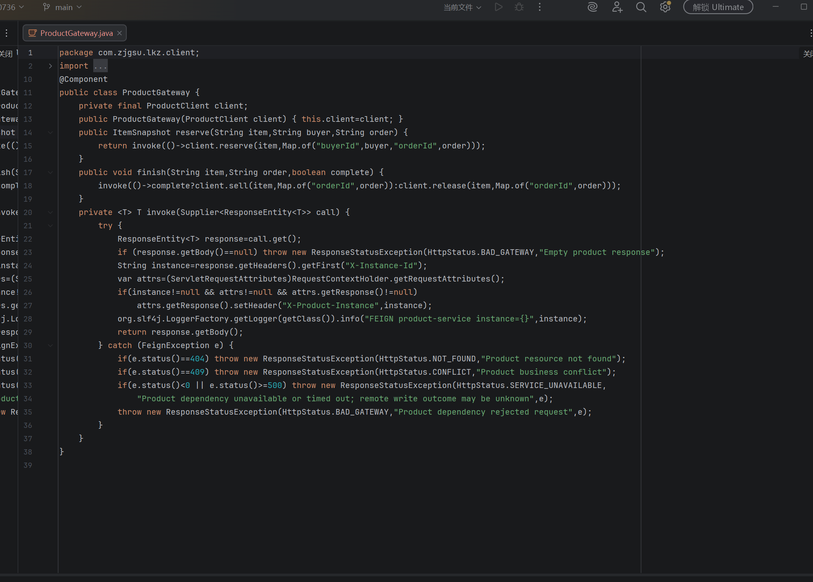
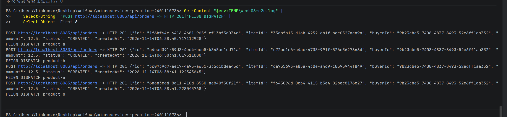
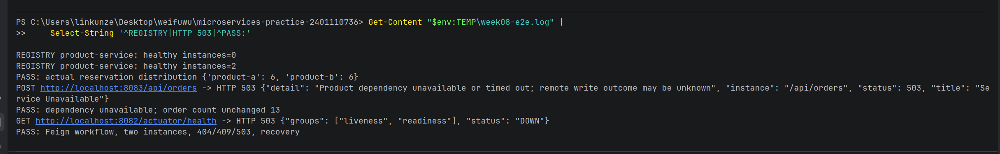
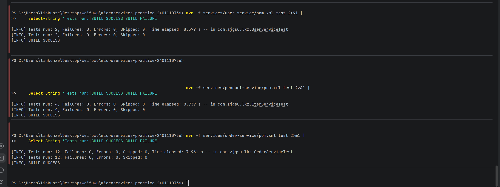

# Week 08 服务通信与负载均衡

林昆泽，2401110736。公开仓库：https://github.com/lkzzzz219/microservices-practice-2401110736

## 选择一个跨服务业务流程

选择创建订单：order-service 收到 POST /api/orders 后先验证买家，使用 Feign 调用 product-service 的 POST /api/items/{id}/reserve，预订成功才保存订单与金额快照。取消、成交分别调用 /release、/sell。商品状态仍由商品服务负责，两个实例共享其自有商品库；订单、用户库独立，原单体和旧周次保留。完整接口、边界和 Mermaid 图见 [调用链设计](../../service-communication.md)。

## 使用 OpenFeign

订单工程沿用统一 BOM，新增 OpenFeign 和 LoadBalancer Starter；Application 启用 @EnableFeignClients。ProductClient 使用 @FeignClient(name="product-service")，没有固定 URL。ProductGateway 调用 reserve/release/sell，保留 404、409；空实例、依赖 5xx、网络和超时错误返回清晰 503 ProblemDetail。禁用 Feign 与负载均衡自动重试，连接/读取超时默认 2000/3000ms，环境变量可覆盖。用户校验和商品发布原有流程保留。

本人在 IDEA 中截图：Feign 客户端按服务名调用商品预订、释放和售出接口。



ProductGateway 展示实际调用、实例响应头透传和异常转换；写超时明确提示远端结果可能未知。



通过订单入口发起真实下单，返回 HTTP 201 和 CREATED JSON，随后的 FEIGN DISPATCH 标识来自真实商品响应。



## 负载均衡验证

订单服务显式配置 RoundRobinLoadBalancer，按发现的商品实例轮询。验证时先连续创建十二笔订单，记录预订的实例，再统一取消，避免预订与取消交替调用使观察到的预订标识恰好相同。

根 compose.yaml 编排 product-service 和 product-service-2。两者 Spring 服务名均为 product-service，同属 public / PERSONAL_GROUP，容器监听 8082，宿主机分别为 8082 与 8084。INSTANCE_ID 分别为 product-a/product-b，通过真实商品 HTTP 响应的 X-Instance-Id 回传，订单响应增加 X-Product-Instance，日志记录 FEIGN 和 INSTANCE。

```powershell
docker compose up -d --build
python scripts/nacos-admin.py list
docker compose ps
```

首次 Nacos 初始化依旧按根 README 的 prepare、单独启动 Nacos、init，再启动业务服务。已有数据卷无需重复初始化。

上方成功下单截图显示 product-a、product-b 交替收到请求；下方完整统计显示十二次预订中两个实例各命中六次。



## 测试

从仓库根目录执行（Windows 使用 Git Bash）：

```bash
bash scripts/e2e-test.sh
```

该入口切换到根目录并执行同目录 Python 驱动，需要 Python 3、Docker、curl（原烟测使用）。驱动等待四个应用端口健康、两个商品实例注册，创建全新买卖双方和商品，连续十二次通过订单入口预订，断言业务 JSON、价格、商品状态及两个真实实例标识。随后验证取消、成交、重复预订 409、资源不存在 404 与订单数不变；停止两个商品实例，验证 503 且订单数不变，在 finally 中恢复两个实例，等待健康与注册后再下单成功。任一断言失败非零退出，不能把失败当业务成功。每次产生独立 UUID，不要求数据库为空，也不删卷。

分别执行服务测试：

```powershell
mvn -f services/user-service/pom.xml test
mvn -f services/product-service/pom.xml test
mvn -f services/order-service/pom.xml test
```

也可进入各服务目录运行 .\mvnw.cmd test（Git Bash 为 ./mvnw test）。终端 mvn -version 应使用 JDK 25。测试关闭 Nacos 注册、使用 H2 和本机 HTTP fixture。订单测试为负载均衡子上下文提供模拟 DiscoveryClient 的实例 supplier 和测试 RoundRobinLoadBalancer，避免 Alibaba 默认负载均衡器访问真实 Nacos。包括 Feign 成功、404/409/503、空实例、动态实例变化、读超时、无本地写入与写请求不自动重试。

写操作超时只表示未得到明确成功响应，远端商品可能已提交，因此结果可能未知。零本地订单不代表远端没有预订，应按订单 ID/reservationId 核对。当前未实现自动补偿或分布式事务。

本人实际运行三个工程的测试：用户 2、商品 4、订单 12，全部 BUILD SUCCESS，Failures 与 Errors 均为 0。



端到端失败恢复截图与上一节共用同一张原图：商品无实例时下单返回 503，订单数保持 13；最终 PASS 表示脚本检查的恢复后下单成功。截图中的 Actuator DOWN 是恢复过程的中间状态，不代表最终检查失败。


## 手动截图操作

截图由本人完成并放入本目录 screenshots/，不使用旧周次截图证明本周结果。

1. 第 2 题：IDEA 打开 ProductClient.java、ProductGateway.java 与 OrderService.java，展示服务名 Feign 调用和错误处理；终端展示真实下单 HTTP 201、CREATED 及 X-Product-Instance/FEIGN DISPATCH。
2. 第 3 题：执行 e2e 后截取 FEIGN DISPATCH product-a、product-b 和最终分布统计。可另截 Nacos 的两个实例，但注册列表不能替代分发证据。
3. 第 4 题：截图测试 BUILD SUCCESS、Tests run，以及 e2e 的 404/409/503、order count unchanged 和恢复成功 PASS。截图不要显示 .env 或凭据。

IDEA PowerShell 可运行：

```powershell
& 'C:\Program Files\Git\bin\bash.exe' scripts/e2e-test.sh 2>&1 |
    Tee-Object "$env:TEMP\week08-e2e.log"
$e2eExit = $LASTEXITCODE
Get-Content "$env:TEMP\week08-e2e.log" | Select-String 'FEIGN DISPATCH|PASS:|HTTP 503'
Write-Host "本次端到端验证退出码：$e2eExit"
```

## 实际验证结果

2026-11-14 在本机 Docker Compose 环境完成实际运行验证：

| 检查 | 实际结果 |
| --- | --- |
| 独立测试 | user-service 2、product-service 4、order-service 12，共 18 个；全部 BUILD SUCCESS，失败和错误均为 0 |
| 健康与注册 | 8081、8082、8083、8084 健康均为 UP；product-service 注册两个健康实例 |
| 真实 Feign 分发 | 连续十二次下单均返回 201，product-a 命中 6 次、product-b 命中 6 次；响应为 CREATED，商品变为 RESERVED |
| 取消、成交 | 十二笔订单取消后商品恢复 ON_SALE；另一笔成交后订单 COMPLETED、商品 SOLD |
| 业务失败 | 重复预订返回 409；不存在的商品返回 404，本次买家订单数保持 13 |
| 依赖停止 | 两个商品实例停止后注册表健康实例数为 0，新商品下单返回 503，订单数保持 13 |
| 恢复 | 两个商品实例恢复健康并重新注册；之前未成功预订的商品仍为 ON_SALE，再次下单返回 201，订单数从 13 增为 14 |
| 端到端退出结果 | bash scripts/e2e-test.sh 返回 0，输出 PASS: Feign workflow, two instances, 404/409/503, recovery |
| 原烟测兼容 | bash scripts/smoke-test.sh 返回 0，健康、订单生命周期、冲突和资源不存在检查通过；停机模式同步停止/恢复两个商品实例 |

测试中的写超时只断言明确失败响应、不新增本地订单和仅调用一次，不证明远端写入一定未发生。原始日志放在被忽略的 .artifacts/，本周目录仅保留 index.md 与 screenshots/。本周五张截图均为本人 2026-11-14 在 IDEA 中实际运行的截图，按题目在上文嵌入；重复证据共用原图，没有修改截图内容。
