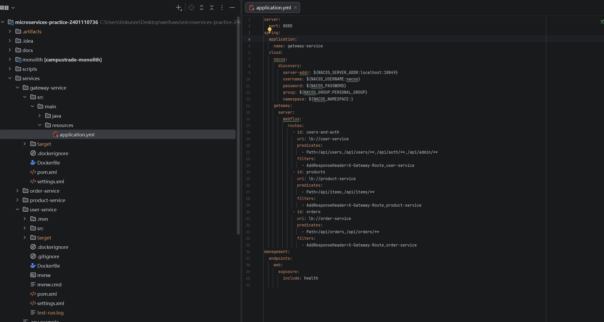
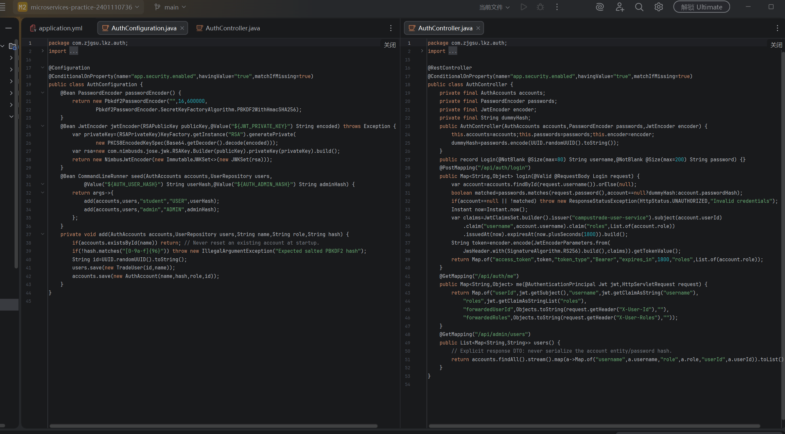
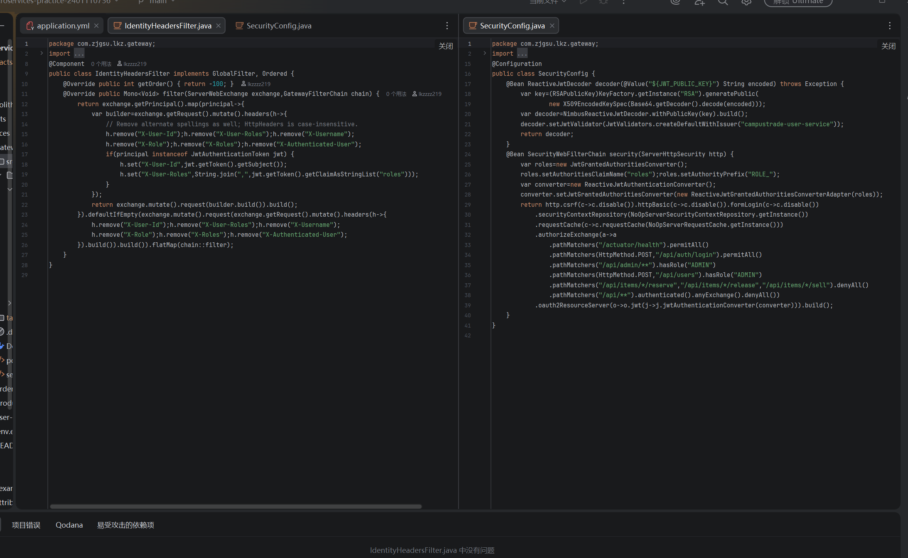
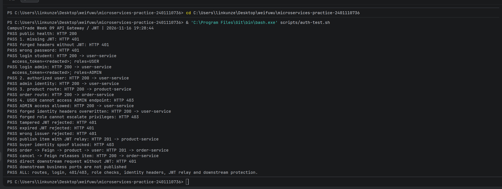

# Week 09：API 网关与认证授权

林昆泽，2401110736。个人仓库：[CampusTrade](https://github.com/lkzzzz219/microservices-practice-2401110736)。本周在此前用户、商品双实例和订单微服务上实现；原单体与 Week 01–08 记录保留。

## API Gateway

独立工程为根目录 `services/gateway-service/`，使用 Spring Cloud Gateway Server WebFlux。统一业务入口为 `http://localhost:8080`，以 `lb://user-service`、`lb://product-service`、`lb://order-service` 三个服务名配置路由，Nacos 使用 public / PERSONAL_GROUP。`GET /actuator/health` 放行健康检查。路由响应带 `X-Gateway-Route`，用于核对实际转发目标。

根目录 `compose.yaml` 的 gateway-service 通过 `SPRING_APPLICATION_JSON` 明确配置这三条路由，同时配置启动、8080 端口与健康检查；网关 application.yml 保留相同路由，供独立启动使用。认证脚本同时检查根 Compose 的三条服务名路由与实际 HTTP 转发结果。

首次运行（根目录，Docker Desktop、Python 3；Windows Bash 命令使用 Git Bash）：

```bash
python -m pip install -r scripts/requirements-auth.txt
python scripts/nacos-admin.py prepare
python scripts/auth-env.py
docker compose up -d nacos
python scripts/nacos-admin.py init
docker compose up -d --build
python scripts/nacos-admin.py list
docker compose ps
curl http://localhost:8080/actuator/health
```

已有管理员及数据卷时保留现有 `.env`，不要用模板覆盖；prepare 不重置已有私密值。冷启动若业务服务先于 Nacos 就绪退出，等待 init 成功后 `docker compose start user-service product-service product-service-2 order-service gateway-service`。只向外发布 8080 业务端口，下游不再发布原业务端口。健康检查预期 200 / UP；实际验证结论在下方统一记录。

本人实际代码截图：独立网关工程的 application.yml，展示 8080 入口、三条服务名路由与健康检查配置。实际健康检查 200 与三条路由转发结果见下方测试脚本运行截图。



## 认证服务

认证代码位于 `services/user-service/.../auth/`。`POST /api/auth/login` 校验 `auth_accounts` 表的 PBKDF2-HMAC-SHA256 密码哈希，成功后签发 RS256 JWT；至少包含 USER 和 ADMIN 两个角色。密码哈希使用随机 16 字节盐与 600000 次迭代，私钥只注入用户服务。用户名 `student` / `admin`，角色与密码来源见根 README；真实密码和密钥只放 `.env`。

```bash
bash scripts/auth-test.sh
# 直接 Python 运行同一个测试驱动也可以：
python scripts/auth-test.py
```

脚本输出登录 HTTP 200、Bearer 类型、有效期和角色，Token 始终用 `<redacted>` 表示；错误密码返回 401。密码哈希的存储、正确密码匹配、错误密码拒绝和随机盐差异有用户服务自动测试覆盖。

本人实际代码截图：AuthConfiguration.java 与 AuthController.java，展示 PBKDF2 密码编码器、USER/ADMIN 账号初始化与 RS256 JWT 签发。两个角色登录成功与错误密码拒绝结果见下方测试脚本运行截图；截图不包含真实密钥或完整 Token。



## 网关鉴权

网关校验 RSA 签名、签发者和有效期，业务接口默认要求认证，`/api/admin/**` 只允许 ADMIN。`IdentityHeadersFilter` 覆盖客户端伪造身份头，身份来自已验签 JWT。三个下游独立验签，用户服务重复执行管理员规则；Compose 不发布下游业务端口。服务间通过当前 SecurityContext 透传 Bearer Token，保留原商品发布、Feign 下单及取消流程。商品发布与订单操作还检查本人身份，避免仅修改请求体 ID 冒用买卖双方。

认证流程、路由权限表、防伪造头及部署边界见 [security.md](../../security.md)。验证命令仍为 `bash scripts/auth-test.sh`：无 Token 为 401，USER 管理访问为 403，ADMIN 管理访问为 200；伪造身份头被覆盖，篡改/过期/错误签发者令牌返回 401。

本人实际代码截图：IdentityHeadersFilter.java 与 SecurityConfig.java，展示客户端身份头清理覆盖、JWT 验签和 ADMIN 角色规则。401/403/200 实际结果见下方测试脚本运行截图。



## 测试脚本

`scripts/auth-test.sh` 使用 `set -euo pipefail`，切换至仓库根目录，执行 Python 驱动并传播退出码。每次读取本地 `.env`，获取新的两个角色 Token，不硬编码密钥或真实密码，不打印 Token。使用独立商品名称，可重复运行，不依赖空数据库。

```bash
bash scripts/auth-test.sh
# 成功最后输出 PASS ALL；任何断言失败输出 FAIL 并返回非零。
```

```powershell
# JDK 25 与 Maven：原有服务回归与新增密码、鉴权测试
mvn -f services/user-service/pom.xml test
mvn -f services/product-service/pom.xml test
mvn -f services/order-service/pom.xml test
```

脚本检查：公开健康检查、未登录拒绝、错误密码、USER/ADMIN 登录、三条真实路由、低权限越权拒绝、管理员允许、伪造头覆盖与防提权、无 Token 伪造头拒绝、篡改/过期/错误签发者拒绝、买家身份冒用拒绝、真实发布/下单/取消及 Feign Token 透传、下游无 Token 直连 401、下游端口未发布。原始日志仅放被忽略的 `.artifacts/`。

本人实际运行截图：2026-11-16 19:28:44 在个人仓库根目录通过 Git Bash 执行 scripts/auth-test.sh，展示三条路由、登录、401/403、身份头覆盖、JWT 透传和下游保护检查，最终输出 PASS ALL。Token 已由脚本隐藏为 `<redacted>`。



## 实际验证记录

2026-11-16 在本机 Docker Desktop 中实际执行：四个工程构建成功；用户服务 6 个测试（含新增认证测试 4 个）、商品服务 4 个、订单服务 12 个测试全部通过，共 22 个测试，Failures=0、Errors=0。原有测试使用关闭注册的 H2 与 HTTP fixture，新增认证测试启动真实随机端口并使用临时 RSA 密钥，不依赖本地真实密码。

首次运行 `bash scripts/auth-test.sh` 最终 PASS ALL：健康检查 200、无 JWT 401、错误密码 401、USER/ADMIN 登录 200、三条路由转发成功、USER 管理访问 403、ADMIN 管理访问 200、身份头覆盖后仍是 USER、伪造角色仍 403、篡改/过期/错误签发者 401。发布商品和下单为 201，取消为 200；订单调用 Feign、商品校验用户的 JWT 透传成功。容器内部直连用户服务不带 Token 为 401，Compose 的四个下游实例均无宿主机端口映射。

网关、用户、两个商品实例、订单及三个 MySQL 容器均为 healthy，Nacos 在运行。本次脚本在 Git Bash 中遇到多个 Python 解释器，入口现会选用安装了 cryptography 的 Python；找不到时输出清楚的 FAIL 与安装指令并返回非零。原始过程日志留在被忽略的 `.artifacts/`。

再次执行 `bash scripts/auth-test.sh` 仍为 PASS ALL，验证数据无需清空即可重复运行。再次运行 `auth-env.py` 前后 `.env` 文件摘要相同，确认未改动已有密码、哈希和密钥。提交前检查本次改动不包含本地真实密码、JWT 私钥，且 `.env`、原始日志均被 Git 忽略。

本人提供的四张实际截图已归档到本周 screenshots，并在对应部分使用相对链接嵌入。归档文件与原截图逐一校验 SHA-256 一致，未修改图片内容。

提交前于 2026-11-16 19:41:17 再次验证：根 compose.yaml 已显式配置三条服务名路由，Compose 配置校验通过；重新创建网关后执行 `bash scripts/auth-test.sh`，全部 HTTP 场景、Compose 路由配置与下游端口检查均 PASS，最终输出 PASS ALL。截图保持本人 19:28:44 的原始运行结果，新增检查以本次记录为准。

## 作业系统填写文字

公开仓库链接：`https://github.com/lkzzzz219/microservices-practice-2401110736`

1. API Gateway：新增独立网关工程，统一使用8080入口，按用户、商品和订单服务名配置三条路由，通过健康检查及实际业务请求验证转发。
2. 认证服务：用户服务保存带随机盐的密码哈希，登录成功签发含角色的JWT，提供USER和ADMIN账号，使用自动脚本验证登录成功与失败。
3. 网关鉴权：网关校验JWT与角色，无登录返回401、低权限越权返回403，覆盖伪造身份头，下游独立验签且不发布业务端口。
4. 测试脚本：提供可重复执行的auth-test.sh，覆盖未登录、登录、携带令牌、角色越权和伪造头场景，断言失败返回非零退出码。
