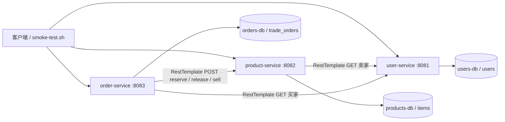
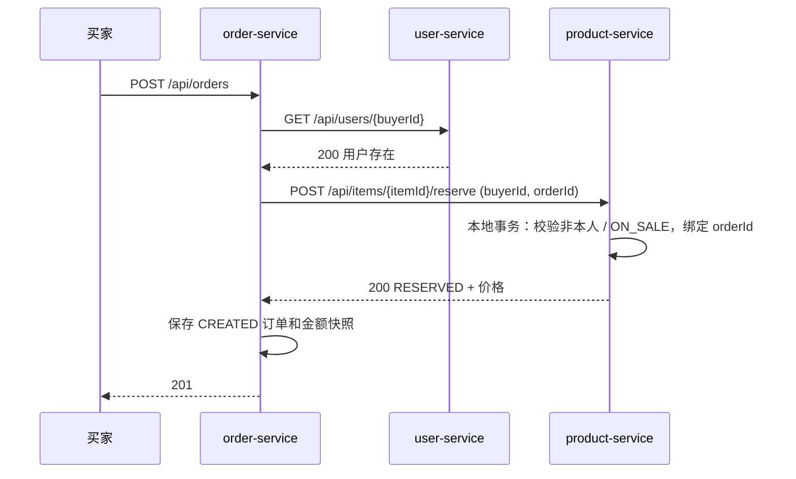

# CampusTrade 微服务拆分设计

作者：林昆泽（2401110736）；新服务基础包：`com.zjgsu.lkz`，业务代码分别放在 controller、service、repository、model、client 子包。原有 `monolith/` 保留原代码及原包名，作为 Week 05 单体对照。

## 拆分映射与数据归属

| 单体模块 | 微服务 | 职责 | 端口 | 独立数据库 / 账号 | 拥有表 |
| --- | --- | --- | --- | --- | --- |
| 规划中的用户模块；原订单、商品仅保存用户字符串 ID | user-service | 新增最小用户创建、查询、存在性校验，不实现认证登录 | 8081 | campustrade_users / users_app | users |
| ItemController、ItemService、ItemRepository、Item | product-service | 商品发布、浏览、详情、锁定、释放、售出；校验卖家存在 | 8082 | campustrade_products / products_app | items |
| OrderController、OrderService、OrderRepository、TradeOrder | order-service | 买家校验、下单、取消、成交、金额快照、订单查询 | 8083 | campustrade_orders / orders_app | trade_orders |

用户身份生命周期、商品状态生命周期、订单交易生命周期各自内聚。商品库存状态属于商品服务，不能为方便下单而由订单服务直接更新商品表。用户模块从选题规划补齐最小接口，不把它描述为单体已实现的注册登录。

Compose 使用三个 MySQL 8.4.11 容器，每个容器有独立数据库、应用账号和命名卷。应用只收到自己的普通账号，未配置其他数据库的凭据；数据库不向宿主机暴露端口。跨服务只存 sellerId、buyerId、itemId，均为普通字符串列，无跨库外键和实体关联，无其他服务 Repository 或 JAR 依赖。

`items.reservation_id` 保存占用它的订单 ID；商品更新使用本地事务和行锁，避免两个订单同时占用同一商品。释放或售出必须匹配 reservation_id。订单终结时也使用本地行锁；这些锁不能提供分布式原子性。

## 调用关系与架构图

全部服务提供 `GET /actuator/health`。默认连接超时 2000ms、读取超时 3000ms，通过 HTTP_CONNECT_TIMEOUT_MS、HTTP_READ_TIMEOUT_MS 覆盖。服务地址来自 application.yml，可由 USER_SERVICE_URL、PRODUCT_SERVICE_URL 覆盖。Compose 使用 user-service、product-service 等 DNS 服务名。健康探针中的 localhost 仅访问本容器自身。

## 跨服务顺序流程

依赖资源不存在返回 404；商品状态冲突、自购等返回 409；连接失败、读取超时、依赖 5xx 返回 503；其他异常远端响应返回 502。异常包含 ProblemDetail 的 status、detail，错误不会被忽略，也不会在校验失败后保存订单。发布商品同样先校验卖家，再写商品。

取消订单先请求 release，再保存 CANCELLED；成交先请求 sell，再保存 COMPLETED。该流程仅演示顺序调用与基本失败处理；没有网关、鉴权、自动重试、自动补偿、消息或跨服务原子事务。

## “远端成功、本地失败”窗口

商品锁定已提交后，若 HTTP 响应丢失、订单服务崩溃或订单数据库写入失败，商品可能 RESERVED 而订单不存在。取消/成交同样可能商品已释放/售出、本地订单仍 CREATED。Spring `@Transactional` 只覆盖本服务数据库，无法回滚已提交的远端请求。当前应记录商品 reservation_id 与订单 ID，人工查询核对并恢复；本周不实现自动补偿，客户端也不应盲目重试。测试和烟测验证正常顺序及失败前无本地写入，不声称已解决这个窗口。
