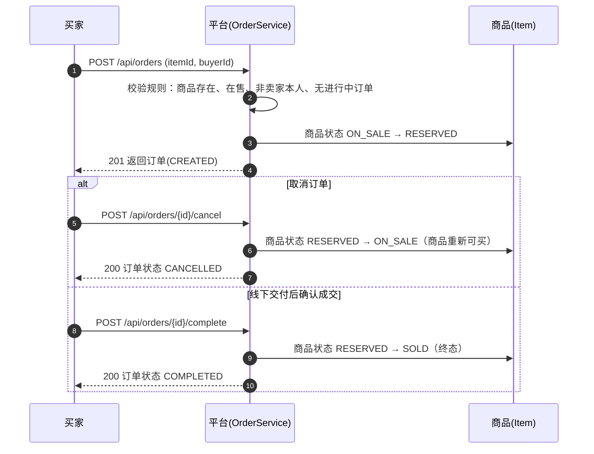

# 项目选题说明（Project Proposal）

## 项目名称

**CampusTrade 校园二手交易平台**

（与第 02 周 README 确定的选题一致，本学期持续演进的唯一课程项目。）

## 目标用户

| 角色 | 说明 |
| --- | --- |
| 游客 | 未登录访客，可浏览商品、注册 |
| 学生（买家） | 搜索商品、下单购买、与卖家沟通、评价 |
| 学生（卖家） | 发布与管理闲置商品、处理订单 |
| 管理员 | 认证审核、违规处理、数据概览 |

## 准备优先实现的业务场景

**「学生发布闲置商品 → 其他学生浏览并下单」的核心交易场景**，即第 02 周 README 中核心业务流程的前半段：

1. 卖家发布商品（标题、描述、价格、分类）；
2. 买家浏览/搜索商品列表与详情；
3. 买家对商品下单，订单进入「待确认」状态；
4. 卖家确认订单，商品锁定，订单进入「已确认」；
5. 双方线下交付后标记成交，商品自动下架，双方互评。

优先实现它的原因：它是平台价值的最大闭环，覆盖用户、商品、订单三个最核心模型；消息沟通与搜索可以随后叠加。

## 两个核心模型（Week 04 已按此实现）

### 模型一：商品（Item，表 `items`）

| 字段 | 类型 | 说明 |
| --- | --- | --- |
| id | String(UUID) | 主键 |
| seller_id | String | 发布者（卖家）用户 id |
| title | String(100) | 标题，非空 |
| description | String(1000) | 描述 |
| price | Decimal(10,2) | 价格（元），必须大于 0 |
| status | 枚举字符串 | ON_SALE 在售 / RESERVED 被订单锁定 / SOLD 已售出 |
| created_at | LocalDateTime | 发布时间，非空 |

### 模型二：订单（TradeOrder，表 `trade_orders`，避开 SQL 保留字 ORDER）

| 字段 | 类型 | 说明 |
| --- | --- | --- |
| id | String(UUID) | 主键 |
| item_id | String | 商品 id（逻辑外键指向 items.id），非空 |
| buyer_id | String | 买家用户 id，非空 |
| amount | Decimal(10,2) | 成交金额快照（下单时复制商品价格，不受后续改价影响），非空 |
| status | 枚举字符串 | CREATED 进行中 / COMPLETED 已成交 / CANCELLED 已取消 |
| created_at | LocalDateTime | 下单时间，非空 |

两实体关系：一个商品在任意时刻最多关联一条进行中的订单（Order.itemId → Item.id，逻辑外键）；订单只保存商品 id 与买家 id，不直接持有商品对象，与课堂实践「Enrollment 只存 studentId/courseId」的解耦方式一致。

订单状态只允许沿「CREATED → COMPLETED / CANCELLED」路径流转，终态不可再变，由 Service 层规则保证。

## Week 04 业务建模：本周实现的核心业务流程

**流程：买家下单 → 取消/成交的商品状态联动**

**在 Service 中检查的业务规则**（`OrderService.placeOrder`，任一不满足即拒绝且不产生任何修改）：

1. 商品必须存在，否则 404；
2. 商品必须处于 ON_SALE（被锁定或已售出的商品不能下单），否则 409；
3. 买家不能购买自己发布的商品（sellerId == buyerId 拒绝），否则 409；
4. 同一商品不能同时存在两条 CREATED 状态的订单，否则 409；
5. 全部通过后创建订单（金额取商品价格快照）并将商品置为 RESERVED，两次写入在同一事务中完成。

取消与成交规则：只有 CREATED 状态的订单可以取消/成交；取消后商品回到 ON_SALE（可重新下单），成交后商品 SOLD（终态）。

## 历史实现范围（Week 03）

Week 03 仅完成 Spring Boot 工程起步：可运行的空壳工程、`/api/hello` 运行状态验证接口、`/actuator/health` 健康检查和 `@SpringBootTest` 启动测试，不包含业务模型代码实现。
