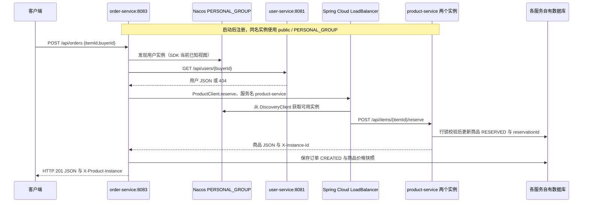

# CampusTrade 服务通信与负载均衡

## 场景与边界

创建订单必须验证真实买家和商品。调用方 order-service（8083）通过既有 DiscoveryClient/HTTP 查询 user-service（8081），再通过 OpenFeign 按服务名 product-service 预订商品，最后保存本地订单及价格快照。取消与成交也通过 Feign 释放或售出商品。商品发布时原有的用户校验继续保留。

用户资料归 users 库，商品及预订状态归 products 库，订单归 orders 库。两个商品实例共同使用商品服务自己的数据库与账号，不建立第二套商品数据，也不直接读写订单库。数据库行锁和 reservationId 归属检查沿用原实现。

## 接口与实例标识

| 调用方 | 被调用方 | 接口 | 成功结果 |
| --- | --- | --- | --- |
| order-service | user-service | GET /api/users/{buyerId} | 用户 JSON |
| order-service | product-service | POST /api/items/{id}/reserve | 商品 JSON |
| order-service | product-service | POST /api/items/{id}/release | 商品 JSON |
| order-service | product-service | POST /api/items/{id}/sell | 商品 JSON |

ProductClient 的 @FeignClient(name="product-service") 不配置 url。统一 BOM 管理 OpenFeign 与 LoadBalancer 版本，未覆盖 Nacos Client。ProductLoadBalancerConfiguration 在负载均衡子上下文显式使用 RoundRobinLoadBalancer，对发现的实例进行轮询。两个容器注册同一 spring.application.name；宿主机分别映射 8082:8082 与 8084:8082，容器间用注册的实际地址通信。

InstanceHeaderFilter 在真实商品响应中加入 X-Instance-Id（product-a 或 product-b），并记录 INSTANCE 日志；ProductGateway 将本次真实响应头转发为 X-Product-Instance。e2e 连续对不同商品下单十二次，统计这十二次预订请求的真实标识并断言两个实例均命中。注册列表、直接访问 8082/8084 或健康接口都不能替代这个分发断言。不承诺每次精确均分，实例变化会影响分发。

## 错误与超时

保留参数 400、依赖资源不存在 404、业务冲突 409。Feign 空实例导致的 503、依赖 5xx、连接错误和超时转为清晰的 503 ProblemDetail，其它远端拒绝转为 502。没有成功兜底，不跳过校验保存订单。连接/读取超时继续从 HTTP_CONNECT_TIMEOUT_MS / HTTP_READ_TIMEOUT_MS 读取，默认 2000/3000ms。

Feign Retryer.NEVER_RETRY 与 LoadBalancer retry.enabled=false 明确禁用自动重试写操作。写请求读取超时时，商品服务可能已经提交预订、只是响应没到达，不能断言远端没有执行。本地未新增订单也不能证明远端回滚。需要按订单 ID/reservationId 核对，目前没有实现自动补偿或分布式事务。e2e 停机验证是服务不可达场景，另有 Feign 写超时测试验证 503、零本地记录和仅一次 HTTP 请求。

参考：[Spring Cloud OpenFeign 官方说明](https://docs.spring.io/spring-cloud-openfeign/reference/spring-cloud-openfeign.html)，[配置属性](https://docs.spring.io/spring-cloud-openfeign/reference/configprops.html)。
